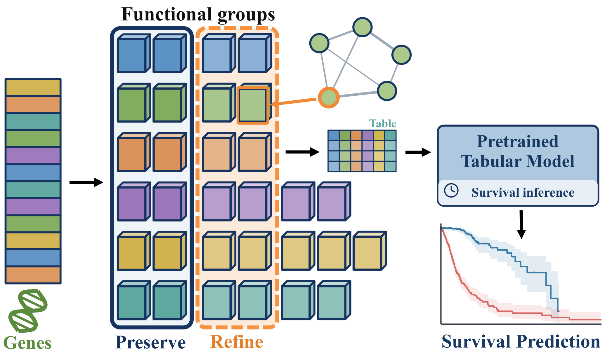
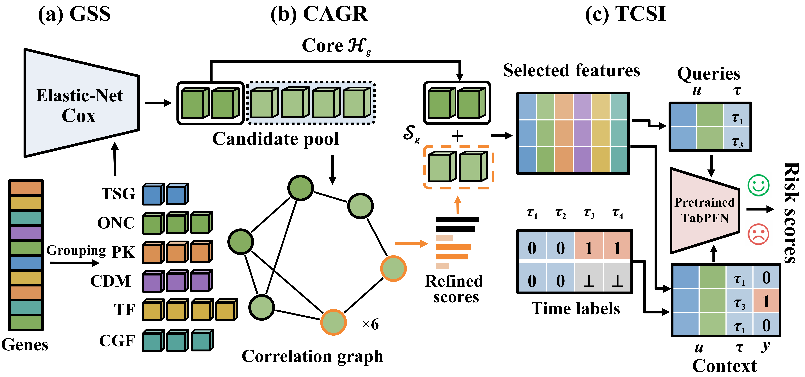
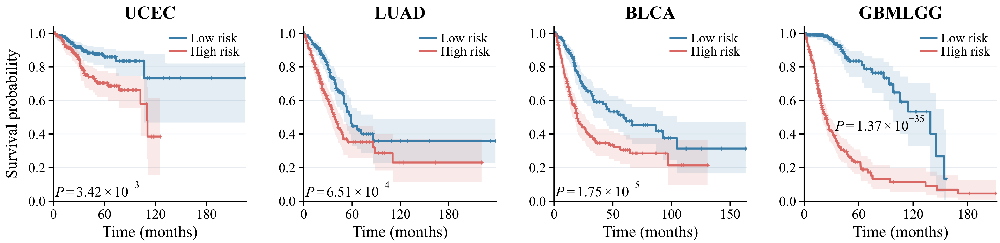

# FICER-Surv

**Function-Informed Core-Preserving Evidence Refinement for Cancer Survival Prediction**

**Built with PriorLabs-TabPFN**

Public inference implementation: **TabPFN-FICER-Surv**, using the frozen **TabPFN-3** backbone. FICER-Surv is the paper and framework name; the implementation identifier carries the TabPFN prefix specified in the dependency's additional attribution provision.

FICER-Surv predicts cancer survival risk from gene-level molecular profiles. Group-aware survival screening (GSS) selects outcome-relevant features within six functional groups. Core-anchored graph refinement (CAGR) preserves strong screening evidence and refines the remaining selection. Time-conditioned survival inference (TCSI) uses the selected measurements and observable patient–time labels to condition a frozen TabPFN-3 classifier.



## Abstract

Accurate cancer survival prediction benefits from tumor molecular profiles, including mutation status, copy-number changes, and RNA expression. However, high dimensionality and right censoring challenge prognostic learning from small cohorts. To reduce the need for cohort-specific training, in-context learning reuses pretrained predictive priors through labeled patient contexts without updating backbone weights. Effective transfer therefore requires compact, outcome-relevant molecular evidence and observable, censoring-compatible context labels. We propose FICER-Surv, a function-informed, core-preserving framework that refines molecular contexts for pretrained survival inference. Group-aware survival screening allocates functional-group budgets and uses Elastic-Net Cox to select evidence supported by censored outcomes. To incorporate molecular relationships while preserving strong prognostic signals, core-anchored graph refinement protects high-priority variables and propagates importance over within-group correlation graphs to revise non-core inputs. Time-conditioned survival inference combines selected measurements with observable patient–time cumulative-event labels, excluding unknown censored states; frozen TabPFN uses these contexts to estimate cumulative-event probabilities, survival curves, and risk. Experiments on four cohorts from The Cancer Genome Atlas show improved average prognostic discrimination over the evaluated baselines under matched feature budgets.

## Framework



## Installation

The implementation is tested with Python 3.12, PyTorch 2.7.1 with CUDA 12.8, and TabPFN 8.2.0. An NVIDIA GPU is recommended. CPU inference is supported but slower.

```bash
conda create -n ficer-surv python=3.12 -y
conda activate ficer-surv
python -m pip install torch==2.7.1 --index-url https://download.pytorch.org/whl/cu128
python -m pip install -r requirements.txt
```

### TabPFN access and first run

This implementation fixes `tabpfn==8.2.0` and explicitly selects **TabPFN-3**. Keep this version and checkpoint to reproduce the reported results.

1. With `checkpoint` set to `null`, the official TabPFN package obtains its classifier weights on first use. Its download flow requires a Prior Labs account and acceptance of the applicable model license. Follow the browser sign-in prompt or visit [Prior Labs](https://ux.priorlabs.ai).
2. For a terminal without a browser, accept the license through your own account's License tab and set `TABPFN_TOKEN` in the environment before running. Keep tokens private; do not put them in `options.json`, source files, or commits.
3. With a legitimately obtained local checkpoint, provide its path directly. No repeated weight download is needed:

```bash
python main.py --dataset ucec --fold 0 --checkpoint /path/to/tabpfn-v3-classifier-v3_default.ckpt
```

Weights are **not included** in this repository. The local-checkpoint route supports offline inference after dependencies and weights have been obtained. This project uses the locally installed TabPFN package rather than the hosted TabPFN Client API. See the [version-specific official setup instructions](https://github.com/PriorLabs/TabPFN/blob/v8.2.0/README.md#installation--setup) for account and download troubleshooting.

### Third-party licenses

The installed TabPFN 8.2.0 code is covered by the **Prior Labs License, version 1.2 (Apache 2.0 with an additional attribution provision)**. TabPFN-3 weights have a separate **TABPFN-3 Non-Commercial License**. In particular, availability of the Python package does not remove the conditions on model weights or outputs. The weight license covers qualifying non-commercial research and evaluation subject to its terms; commercial use, production deployment, and hosted services require separate authorization from Prior Labs.

Unmodified copies of both licenses are included under [`licenses/`](licenses/). Attribution, the precise use of upstream implementations, data provenance, and references are documented in [`NOTICE`](NOTICE) and [`THIRD_PARTY_NOTICES.md`](THIRD_PARTY_NOTICES.md). These notices do not grant permission on behalf of upstream rights holders, replace their terms, or represent approval by Prior Labs. This repository is a research implementation and does not provide a clinical service.

## Run

Run one held-out fold:

```bash
python main.py --dataset ucec --fold 0
```

Run all five folds for a cohort:

```bash
python main.py --dataset ucec --fold all
python main.py --dataset luad --fold all
python main.py --dataset blca --fold all
python main.py --dataset gbmlgg --fold all
```

Change the feature budget, model seed, or core fraction:

```bash
python main.py --dataset luad --fold all --num-features 300 --seed 7 --output outputs/luad_run
python main.py --dataset luad --fold 0 --core-fraction 0.9 --device cuda --output outputs/luad_core09
```

Each held-out fold produces `predictions.csv`, `features.csv`, and `metrics.json`. A cohort-level `summary.json` contains the mean C-index and sample standard deviation across the requested folds. Existing fold outputs are not overwritten; use a different `--output` directory for another run.

## Options

`main.py` is the only command-line entry point. All model parameters and dataset paths are in `options.json`.

| Option | Meaning | Default |
|---|---|---|
| `num_features` | Total molecular feature budget | 300 |
| `seed` | TabPFN seed and fold-generation seed for custom data | 7 |
| `core_fraction` | Core fraction for custom data or an explicit override | 0.9 |
| `datasets.*.core_fractions` | Fixed core fraction for each provided fold | Per-cohort list |
| `num_bins` | Number of time intervals; the default gives up to four query horizons | 5 |
| `pool_multiplier` | Expanded candidate budget within a group | 1.5 |
| `elastic_net` | Cox regularization path and coefficient threshold | See JSON |
| `graph` | Neighbor count, correlation threshold, and smoothing strength | 8, 0.3, 0.2 |
| `n_estimators` | TabPFN ensemble size before automatic scaling | 8 |
| `device` | `auto`, `cuda`, or `cpu` | `auto` |
| `checkpoint` | Local TabPFN-3 checkpoint, or automatic download | `null` |

Command-line arguments override the corresponding JSON values. The provided cohorts use their existing patient folds and the per-fold core fractions listed in the configuration. `--core-fraction` overrides those lists.

## CSV data

The `data` directory contains the four molecular candidate tables and the functional gene signatures. Each cohort CSV contains all signature-matched candidate measurements. GSS and CAGR select the input features during fitting.

| File | Cohort | Patients | Events | Candidate features |
|---|---|---:|---:|---:|
| `ucec.csv` | Uterine Corpus Endometrial Carcinoma | 480 | 75 | 1589 |
| `luad.csv` | Lung Adenocarcinoma | 453 | 158 | 3229 |
| `blca.csv` | Bladder Urothelial Carcinoma | 373 | 169 | 3156 |
| `gbmlgg.csv` | Glioblastoma & Lower Grade Glioma | 568 | 187 | 2461 |

Each row is one patient. The required columns are:

| Column | Meaning |
|---|---|
| `case_id` | Unique patient identifier |
| `survival_months` | Observed follow-up time in months |
| `event` | 1 for an observed event; 0 for right censoring |
| `fold` | Held-out fold index, 0–4 for the provided cohorts |
| Molecular columns | Numeric measurements; missing values are allowed |

`event` is the inverse of the `censorship` field in the source TCGA tables. IDs, outcomes, and fold assignments are excluded from molecular predictors. Molecular values are retained without cohort-wide imputation or standardization. Screening statistics, correlations, and time grids are estimated from the training patients of each fold.

`signatures.csv` defines six groups in priority order: tumor suppressor genes, oncogenes, protein kinases, cell differentiation markers, transcription factors, and cytokines and growth factors. A feature is assigned to its first matching group. Feature names may be gene symbols or use the suffixes `_rnaseq`, `_cnv`, and `_mut`.

For another cohort, use the same CSV schema and edit the column names in `options.json` if needed:

```bash
python main.py --data /path/to/cohort.csv --fold all --core-fraction 0.9 --output outputs/custom
```

If `fold` is absent, the runner constructs event-stratified folds using `num_folds` and `seed`. New gene groups can be supplied by changing `signatures` to another CSV with one gene list per column.

## Paper results

Five-fold mean C-index at a 300-feature budget:

| UCEC | LUAD | BLCA | GBMLGG | Overall |
|---:|---:|---:|---:|---:|
| 0.6403 | 0.6416 | 0.6677 | 0.8563 | 0.7015 |

Overall is the unweighted mean of the four cohort means. Cohort means use all five held-out folds; running all four cohorts gives the overall score.



## Files

```text
FICER-Surv/
  main.py
  options.json
  requirements.txt
  README.md
  NOTICE
  THIRD_PARTY_NOTICES.md
  ficer_surv/
    __init__.py
    model.py
    gss.py
    cagr.py
    tcsi.py
    data.py
  licenses/
    TabPFN-8.2.0-LICENSE.txt
    TabPFN-3-LICENSE.txt
    MCAT-LICENSE.txt
  data/
    signatures.csv
    ucec.csv
    luad.csv
    blca.csv
    gbmlgg.csv
  assets/
    motivation.png
    framework.png
    survival.png
```

`model.py` combines the stages; `gss.py` implements group-aware screening and feature budgets; `cagr.py` implements correlation graphs and core-preserving refinement; `tcsi.py` constructs observable patient–time contexts, calls the official frozen TabPFN implementation, and recovers survival curves and risks. `data.py` reads and validates CSVs and their patient folds. Public model access is `from ficer_surv import FICERSurv`; the command-line entry remains `main.py`.

## Acknowledgments

We thank the Prior Labs team and TabPFN contributors for making their implementation and pretrained models available. FICER-Surv uses their implementation code through the installed `tabpfn` package, including `TabPFNClassifier` and `ModelVersion.V3`. This repository does not vendor the TabPFN source tree or distribute its pretrained weights; the frozen backbone remains the upstream model.

The cumulative-event classification formulation used in TCSI follows Kim, Lai, and Zhang's [Tabular Foundation Models Can Do Survival Analysis](https://arxiv.org/abs/2601.22259). Molecular and survival data originate from [The Cancer Genome Atlas](https://www.cancer.gov/ccg/research/genome-sequencing/tcga), and `data/signatures.csv` is retained from the [MCAT](https://github.com/mahmoodlab/MCAT) functional gene lists. We acknowledge these methodological and data contributions separately from the FICER-Surv evidence-construction stages.

## References

- Grinsztajn et al. [TabPFN-3: Technical Report](https://arxiv.org/abs/2605.13986), 2026.
- Hollmann et al. [Accurate predictions on small data with a tabular foundation model](https://doi.org/10.1038/s41586-024-08328-6), Nature, 2025.
- Kim, Lai, and Zhang. [Tabular Foundation Models Can Do Survival Analysis](https://arxiv.org/abs/2601.22259), 2026.
- Chen et al. [Multimodal Co-Attention Transformer for Survival Prediction in Gigapixel Whole Slide Images](https://openaccess.thecvf.com/content/ICCV2021/html/Chen_Multimodal_Co-Attention_Transformer_for_Survival_Prediction_in_Gigapixel_Whole_Slide_ICCV_2021_paper.html), ICCV, 2021.
